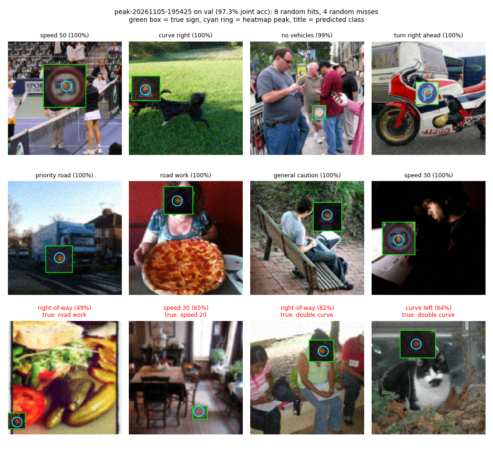

# FindTheObject-CNN

A small CNN that finds a traffic sign in an image and names it: one output is a 32×32 heatmap of where the
sign is, the other is which of the 43 GTSRB sign classes it is. See [DETAILS.md](DETAILS.md) for the plan.

## Results

Scored once on a held-out test set of 5,000 synthetic scenes. Full write-up, setup and caveats in
[RESULTS.md](RESULTS.md).

| Version | Test joint acc | Class acc | Pointing acc | Median center error |
|---|---|---|---|---|
| v1.5 classify at the heatmap peak | **95.9%** | 95.9% | 99.6% | 1.58 px |
| v1 baseline | 94.2% | 94.2% | 99.7% | 1.58 px |

*Joint* = the heatmap's peak lands inside the sign **and** the class is right.

## What the model sees

Random validation scenes from v1.5: eight it gets right (top) and four it gets wrong (bottom row, true class in
red). The orange glow is the predicted heatmap; the cyan ring marks its peak; the green box is the true sign.
In all four misses the model found the sign but named a look-alike.



Regenerate with `python scripts/make_demo_figure.py --checkpoint outputs/checkpoints/<run>/best.pt`.

## Try it on your own images

```
python scripts/infer.py --checkpoint outputs/checkpoints/<run>/best.pt photo1.jpg photo2.png
```

Prints the predicted sign, its confidence and where the heatmap peaks, and saves an overlay per image to
`outputs/infer/`. Images are center-cropped and resized to 128×128 (`--size` to change). The model was
trained only on synthetic scenes with one sign each, so it always names a sign, even when there is none.
